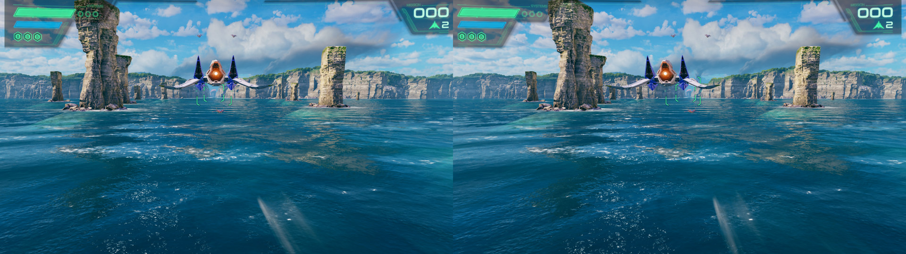
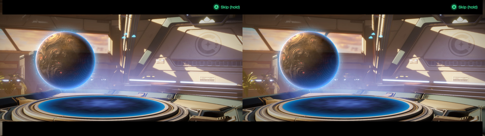
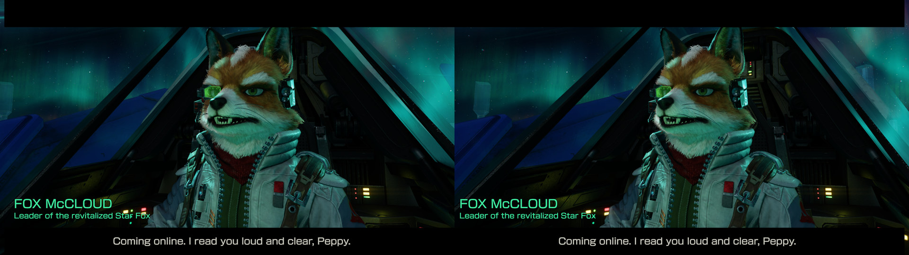

# SpaceAnimalsRecomp 3D

Play **Star Fox for Nintendo Switch 2** natively on your PC, in **real stereoscopic 3D**: on a passive 3D monitor,
a 3D TV or projector, or a glasses-free Leia SR display.

This is the 3D edition of [SpaceAnimalsRecomp](https://github.com/SerenityG4K/SpaceAnimalsRecomp) by
[SerenityG4K](https://github.com/SerenityG4K), a static recompilation of the game into a native Windows program.
This edition renders each eye with its own camera, so the depth comes from the game's real geometry: no depth-buffer
reconstruction, no 2D-plus-depth conversion. Lasers, explosions, holograms and water reflections all sit where they
belong.

It is also ahead of the original on shaders: **all 2,468 of the game's shader stages translate**, where
SpaceAnimalsRecomp 1.1.0 still leaves 80 untranslated.

*Corneria. Full side by side, left eye on the left: view it on a 3D display, in a VR viewer, or with the parallel
free-viewing method. More [below](#screenshots).*

> [!NOTE]
> **Unofficial fan project.** Not affiliated with or endorsed by Nintendo or Leia. **No game files are included**: you
> need your own copy of Star Fox for Nintendo Switch 2, updated to 2.0.0 and dumped from your own console as a `.nup`
> file. This project doesn't include, and won't provide, game files, keys, firmware, dumping or decryption tools, or
> instructions to get any of them. SpaceAnimalsRecomp never decrypts anything and never modifies your file: the game
> code is recompiled locally, on your PC, from your copy.

> [!IMPORTANT]
> **Made almost entirely with AI.** Nearly all of the code, tooling, reverse engineering and documentation, in the
> original and in this edition, is written by an AI (Anthropic's Claude, through Claude Code), directed, tested and
> reviewed by a human: SerenityG4K for SpaceAnimalsRecomp, agrofubris for the 3D edition. If you don't trust code
> written by AI, you can simply ignore this project. As with anything on the internet, you run it at your own
> discretion.

## What this edition adds

Everything from SpaceAnimalsRecomp 1.1.0 is here: the launcher that builds the game from your copy, the 15 languages,
keyboard and controllers, resolutions up to 4K, saves and updates. On top of it:

- **Native stereoscopic 3D** with a **3D** page in the launcher. Outputs: line-interlaced (passive displays), side by
  side, top and bottom, cross-view, and **Leia SR** eye-tracked displays.
- **Automatic convergence** that follows the subject of each shot: it measures the scene's real depth, fades the 3D in
  after each scene cut instead of jumping, and takes transparent objects (holograms, glass) into account.
- **Per-eye effects**: every pass of the main view is drawn for each eye, including post-processing and the planar
  reflections on Corneria's water. The crosshair is true 3D; the HUD gets its own depth, and the markers over your
  wingmen (the arrow and name over Slippy, Peppy and Falco) sit at their wingman's depth.
- **All 2,468 shader stages translated.** SpaceAnimalsRecomp 1.1.0 translates 2,388 and leaves 80 aside; this edition
  translates the remaining 80 too, so no effect is left without its shader. That includes the console's tensor-core
  networks, which run bit-exact on the PC's tensor cores (`VK_KHR_cooperative_matrix`) where available and are
  emulated, with the same results, otherwise.
- The console's own **NDSR** upscaler as an experimental switch (`RECOMP_CONSOLE_UPSCALE=ndsr`).
- **Its own updates**: the launcher only offers this edition's releases, never the original's, which would remove the
  3D.

See the [changelog](CHANGELOG.md) for each version.

## Screenshots

Full side by side, left eye on the left. Captured at depth strength 5 %, automatic convergence, pop-out **Medium**
(1.25) and the interface 2 % in front of the screen.

## Requirements

- **Your own copy**: Star Fox for Nintendo Switch 2 (cartridge or digital) with its **2.0.0 update** (v131072), dumped
  from your own console as a single `.nup` file (title ID `0400E88025B1A000`). The launcher tells you if the file isn't
  the right game or version.
- Windows 10 or 11, 64-bit, on a CPU with AVX2 (2013 or newer).
- A GPU with a Vulkan 1.3 driver. **3D draws the scene twice**, so it needs about twice the graphics power of 2D.
- 32 GB of RAM recommended (with 16 GB, close other programs first), and about 6 GB of free disk space for the build.
- A 3D display, or none: cross-view and side by side also work for free-viewing and VR viewers.

Tested on an AMD Ryzen 9 7950X with an NVIDIA GeForce RTX 3080 at 1080p: 60 fps in 3D in the tutorial and in
Corneria, 57 to 60 in the conversation scenes. Not tested yet on AMD or Intel graphics cards.

## Install

1. Download `SpaceAnimalsRecomp-3D-1.1.2-windows.zip` from
   [Releases](https://github.com/agrofubris/SpaceAnimalsRecomp-3D/releases). It bundles everything the build and the
   game need (Python, Clang, GCC, glslang, SDL3, the Leia SR module, and the FSR and DLSS libraries): nothing else to
   install.
2. Extract it to a folder you can write to, **not** Program Files, whose path has only Latin characters, for example
   `C:\Games\StarFox3D`. Spaces are fine: the compiler is then copied once to `C:\ProgramData\StarFoxRecomp` (about
   400 MB).
3. Run `lanceur.exe` (**EN** at the top right switches it to English). Choose your copy (**COPY › choose**), then click
   **BUILD THE GAME**. The launcher checks your copy, recompiles the whole game code (20 to 30 minutes; the launcher
   stays usable), then compiles every shader for your GPU (about a minute), so there is no shader stutter in game.
4. Open the **3D** page and pick your display's mode (see [Setting up 3D](#setting-up-3d)), then click **PLAY**.

Your copy is never modified. The game's icon is taken from your copy at build time and never distributed.

Already using the original SpaceAnimalsRecomp? Install this edition in its own folder. Both use the same save folder,
`%APPDATA%\SpaceAnimalsRecomp\save`, so your progress carries over.

## Setting up 3D

### Displays

| Your display | 3D mode | Notes |
|---|---|---|
| Passive 3D monitor or TV (polarized glasses, line by line) | **Interlaced** | Borderless full screen at the display's native resolution, so each line of the picture is one line of the screen. Many passive monitors need **Swap eyes**: turn it on if the depth looks inside out. |
| 3D TV or projector (active or passive) | **Side by side** or **Top and bottom** | Each eye is squeezed into half the picture, the format 3D TVs expect; set the TV's 3D mode to match. In a 32:9 window (3840×1080), side by side is full resolution per eye. |
| Leia SR display (Acer SpatialLabs, Samsung Odyssey 3D, ThinkPad 3D…) | **Leia SR (eye tracking)** | See [Leia SR displays](#leia-sr-displays). |
| No 3D display | **Cross-view** | Eyes swapped, each at its own aspect ratio, for cross-eyed free-viewing. **Side by side** suits parallel viewing and VR viewers. |

### Depth

All settings are on the launcher's **3D** page and apply the next time the game starts.

| Setting | What it does | Default |
|---|---|---|
| **Depth strength** | Separation of the eyes for distant objects, in % of the screen width (1 to 6 %). More is deeper. | 3 % |
| **Convergence** | **Automatic** keeps the subject of each shot (the Arwing, a character's face) at the screen plane, adjusted by **Pop-out**. A fixed distance (25 to 2,000 game units) never moves. | Automatic |
| **Pop-out** | With automatic convergence: **Behind the screen** (0.85), **Screen plane** (1.0), **Slight** (1.1), **Medium** (1.25) or **Strong** (1.5): how far the subject comes out of the screen. | Screen plane |
| **Interface depth** | Moves the HUD in front of or behind the screen, in % of the width. The crosshair is already true 3D and doesn't move with it. | Screen plane |
| **Swap eyes** | Swaps the left and right images, for displays that need it. | No |

The same settings are in `recomp\build\full\recomp.ini`, section `[stereo]` (`stereo`, `stereo_swap`,
`stereo_strength`, `stereo_convergence`, `stereo_pop_out`, `stereo_hud_depth`), with comments in the file.

Start at the defaults, then raise the depth strength until it stays comfortable. On a big TV or a projector, keep it
lower: the same percentage is a bigger physical separation on a big screen.

### How it works

- **Two cameras.** The game's camera block is copied for each eye, with the camera moved sideways and an off-axis
  projection, so both eyes see the scene from their own position. Shadows stay shared: they don't depend on the eye.
- **Two images.** Every pass that draws the main view (and its post-processing chain) runs again for the right eye
  into its own copies of the game's images. The dialogue portraits are rendered once, as flat insets.
- **Mirrors too.** Planar reflections (Corneria's water) use a mirrored camera; it gets the same per-eye offset, so the
  reflections have their own depth.
- **Wingman markers.** The game places them by projecting each wingman onto the screen. Each marker is matched to the
  Arwing it points at and gets that Arwing's own parallax; the rest of the HUD keeps the interface depth.
- **Automatic convergence.** The depth at the centre of the screen is read back each frame from the game's own depth
  buffer; transparent objects, which write no depth, are measured from their vertices. The 3D fades in after each
  scene cut, once the new shot is measured, instead of jumping. A subject that comes nearer is followed within about a
  quarter of a second; one that moves away, slowly.
- **Shading at the output's resolution.** Interlaced and top and bottom show each eye on every other line, side by
  side and cross-view on every other column. The 3D passes of each eye shade one sample per two pixels in that
  direction (variable-rate shading), so each pixel you see still gets its own sample; depth and edges stay per pixel.
- **Anti-aliasing.** With 3D on, DLSS and FSR are turned off (one temporal history can't serve two eyes); each eye
  keeps the game's own anti-aliasing. **GRAPHICS › 3D rendering** (85, 75 or 67 %) still works and lowers the cost.

The design notes and measurements are in [docs/DEV-NOTES.md](docs/DEV-NOTES.md).

## Leia SR displays

Leia SR panels track your eyes and weave the two images for glasses-free 3D.

1. Install Leia's **SR Platform** and check that its service runs and the display is enabled in Windows. This project
   ships none of Leia's files; the game's own `sar_leia_sr.dll` is included in the package.
2. On the **3D** page, set **3D mode** to **Leia SR (eye tracking)** and **Swap eyes** to **No**.
3. Play in borderless full screen, with the game window on the SR display.

Without the SR Platform or an SR display, the game shows side by side and says why in its log
(`recomp\build\full\recomp_run.log`). The weave uses the same call pattern as the author's other Leia SR ports, which
was checked on a real panel, but **this game hasn't been played on a Leia SR panel yet**. If you have one,
[docs/LEIA-SR.md](docs/LEIA-SR.md) has a short checklist, and a report is very welcome.

## Known limitations

- Not tested yet: AMD and Intel graphics cards, a real Leia SR panel, and the levels after Corneria in 3D (Area 6
  onward). Please report how they go.
- 3D needs about twice the graphics power. If the frame rate drops, lower **GRAPHICS › 3D rendering** or the
  resolution.
- DLSS and FSR are off in 3D.
- From the original: 90 and 120 fps are not stable yet, and handheld PCs (Steam Deck, Legion Go, ROG Ally) are
  untested.

## Using the game

### Saves

In `%APPDATA%\SpaceAnimalsRecomp\save`. They stay if you reinstall or move the game. A backup is made before every
build and update; to make your own, close the game and copy the whole `save` folder.

### Updates

The launcher checks this repository's releases when it starts (you can turn that off in **SETTINGS**) and asks before
installing one. It downloads the update, checks its SHA-256 hash, installs it and restarts, then offers to rebuild: only
the parts whose code changed are rebuilt. Your copy, saves and settings stay.

### Controls

Xbox, PlayStation (DualShock 4, DualSense), Switch Pro and Joy-Con controllers work, USB or Bluetooth (Switch 2
controllers are not supported yet). Buttons follow the position on the pad (the Switch's A is the Xbox B, and so on).
Change keys and buttons on the launcher's **CONTROLS** page.

| Switch | Keyboard | Xbox controller |
|---|---|---|
| A | C or Enter | B |
| B | X or Backspace | A |
| X | V | Y |
| Y | Z | X |
| L | Q | LB |
| R | E | RB |
| ZL | R | LT |
| ZR | T | RT |
| + | M or Esc | Start |
| − | N or Tab | Back |
| Left stick (click) | W A S D (F) | Left stick |
| Right stick (click) | I J K L (H) | Right stick |
| D-pad | Arrow keys | D-pad |

Alt+Enter or F11 switches between full screen and a window.

### Uninstalling

Click **UNINSTALL** on the launcher's build page, or run `uninstall.bat`. It removes the install folder, the build, the
compiler copy in `C:\ProgramData\StarFoxRecomp`, temporary files and logs. It never touches your copy of the game, and
keeps your saves unless you ask it to remove them.

## Reporting a bug

Report bugs of this edition [here](https://github.com/agrofubris/SpaceAnimalsRecomp-3D/issues), not on the original's
tracker.

- Use the latest release, and search the existing issues first.
- Say which CPU, GPU and GPU driver you use, your display and the 3D mode.
- Click **BUG REPORT** in the launcher and attach the zip it makes: your hardware and all the logs, without your Windows
  user name and without anything from the game. Without the launcher, attach `recomp\build\full\recomp_run.log`, taken
  right after the bug.
- For a picture problem in 3D, say where in the game it happens, and if you can, attach a screenshot in **Side by
  side** mode.

## Building from source

Windows only for now.

1. Clone the repository, then get the toolchain, downloaded from official sources with their SHA-256 hashes checked,
   into `recomp\outils`: `python recomp\launcher\outils.py`. MSYS2 UCRT64 with the same tools works too.
2. Build the launcher: `python recomp\launcher\construire.py` (it writes `lanceur.exe` next to `recomp`).
3. Optional, for Leia SR: build `sar_leia_sr.dll` with Visual Studio (MSVC) and
   [SR-lib](https://github.com/bo3b/SR-lib): `python recomp\leia\construire.py --sr-lib <SR-lib folder>` (or set
   `SAR_SR_LIB_ROOT`). SR-lib brings the headers and import libraries of Leia's SR SDK; no SDK file goes into this
   repository. Without SR-lib (or with `--sans-sr`), the module builds in simulate-only mode (`SAR_LEIA_SIMULATE=1`).
4. Run `lanceur.exe` and build the game from it, or from a shell:
   `python -u recomp\launcher\preparer.py --copie "<your copy>.nup"`.
5. To make release archives: `python recomp\launcher\paquet.py <output folder>`.

The developer notes (in [English](docs/DEV-NOTES.md) and [French](docs/DEV-NOTES-fr.md)) explain how every part
works, how each bug was found, and the debugging switches (`RECOMP_*` environment variables, including the
`RECOMP_STEREO*` ones).

## Respect copyright

- Star Fox is © Nintendo. This is a fan project. It is not affiliated with, endorsed by or sponsored by Nintendo.
  Nintendo Switch and Star Fox are trademarks of Nintendo.
- This repository contains no game files, no game code (also not the C++ code the recompiler generates from it), no
  assets, no keys, and release builds won't either. The screenshots in `docs/screenshots` are pictures of the game
  running from the maintainer's own copy; they are not game files.
- The game code you generate and the build made from it contain Nintendo's code. They are for your own use only:
  don't share them, upload them or ship them.
- Issues, pull requests or discussions that contain game files, keys, generated code or links to pirated copies will be
  removed. Piracy is not supported in any way.
- Follow the copyright laws of your country. Dumping a game you own for personal use is legal in some countries and not
  in others; that is your responsibility.

## Credits

**Star Fox** is © Nintendo. All credit for the game goes to its creators. This project only changes where it runs and
how its picture reaches your eyes.

SpaceAnimalsRecomp:

- **[SerenityG4K](https://github.com/SerenityG4K)**: creator and maintainer of
  [SpaceAnimalsRecomp](https://github.com/SerenityG4K/SpaceAnimalsRecomp), the recompilation this edition is built on:
  the recompiler, the runtime, the launcher, direction, testing and review. Also the author of the Star Fox Command
  native port, whose launcher inspired this one.

The 3D edition:

- **agrofubris**: stereoscopic 3D, the Leia SR output, the remaining shader stages and tensor-core networks, and the
  console's NDSR upscaler: direction, testing and review.
- **[bo3b](https://github.com/bo3b)**: [SR-lib](https://github.com/bo3b/SR-lib) (MIT), the wrapper of Leia's SR SDK
  that the Leia SR module is built on, and years of stereo 3D modding work.
- **[oneup03](https://github.com/oneup03)**: [RT64 3D](https://github.com/oneup03/rt64-3D), whose stereo rendering and
  Leia SR integration this edition's approach follows.
- **masterotaku**: Leia SR panel testing and feedback, which verified the weave pattern this module uses.
- Leia SR is a technology of Leia, Inc.; this project is not affiliated with Leia.

Also:

- **Claude** (Anthropic), through Claude Code: code, tooling, reverse engineering and documentation, under the
  direction of SerenityG4K and agrofubris.
- The static recompilation approach of [N64Recomp](https://github.com/N64Recomp/N64Recomp) and
  [XenonRecomp](https://github.com/hedge-dev/XenonRecomp), which showed the way (no code from them is used).
- The Switch homebrew community's documentation ([Switchbrew](https://switchbrew.org)).
- Libraries and tools: [Capstone](https://www.capstone-engine.org) (BSD), [python-zstandard](https://github.com/indygreg/python-zstandard)
  (BSD), [python-lz4](https://github.com/python-lz4/python-lz4) (BSD), [glslang](https://github.com/KhronosGroup/glslang)
  (BSD-3-Clause and Apache 2.0), the Vulkan headers (Apache 2.0), [GCC](https://gcc.gnu.org) through
  [WinLibs](https://winlibs.com) (GPL 3 with the GCC Runtime Library Exception), [Python](https://www.python.org) (PSF License),
  [SDL](https://www.libsdl.org) (zlib), the [AMD FidelityFX SDK](https://github.com/GPUOpen-LibrariesAndSDKs/FidelityFX-SDK)
  (MIT) and [NVIDIA DLSS](https://github.com/NVIDIA/DLSS) (NVIDIA's license). This software uses NVIDIA DLSS.

## License

SpaceAnimalsRecomp's own code is free software under the **GNU General Public License v3.0** (see [LICENSE](LICENSE)),
© 2026 SerenityG4K. You may use, study, share and modify it. Anything you distribute that is based on it must stay under the
same license, with its source code, and keep the copyright notices and credit to SpaceAnimalsRecomp and SerenityG4K.
The 3D edition's changes are © 2026 agrofubris, under the same license. The Leia SR module (`recomp/leia/` and
`recomp/runtime/os/leia_sr_abi.h`) is under the MIT license, because it links with Leia's proprietary SR SDK; it is a
separate, optional library that the game loads at run time, and no file of the SR SDK is distributed.
Third-party components in `recomp/runtime/third_party/` keep their own licenses. The license covers this project's
code only: it grants nothing for Nintendo's game, which you must supply yourself.

**Additional permission (GPL-3.0 section 7) for NVIDIA DLSS.** If you modify SpaceAnimalsRecomp, or any covered work, by
linking or combining it with NVIDIA DLSS (`nvngx_dlss.dll`, from the NVIDIA DLSS SDK), containing parts covered by the
terms of NVIDIA's DLSS SDK license, the licensor of SpaceAnimalsRecomp grants you additional permission to convey the
resulting work. NVIDIA DLSS is a separate work: the GPL does not apply to it, and it stays under NVIDIA's license.
agrofubris, the licensor of the 3D edition's changes, grants the same additional permission for them. The
AMD FSR libraries are under the MIT license, which is compatible with the GPL.

The full Windows package (`-windows.zip`) also bundles, in its `outils` folder, the unmodified binaries of the build
tools and of the libraries the game loads, under their own licenses. GCC and glslang are reduced to the files the build
uses.

- GCC 16.2.0, GNU Binutils 2.47 and MinGW-w64 14.0.0, from the
  [WinLibs build](https://github.com/brechtsanders/winlibs_mingw/releases/tag/16.2.0posix-23.1.3-14.0.0-ucrt-r3)
  (GPL 3, with the GCC Runtime Library Exception for the runtime libraries; MinGW-w64 under its own permissive licenses),
  with the libraries the compiler uses: GMP, MPFR, MPC (LGPL 3), isl (MIT), libiconv, libintl (LGPL 2.1), zstd (BSD)
  and zlib;
- glslang 16.6.0 (BSD-3-Clause, Apache 2.0 and other free licenses);
- Python 3.13.17 embeddable (PSF License), with zstandard 0.25.0, lz4 4.4.5 and capstone 5.0.7 (BSD);
- SDL 3.4.20 (zlib), for controllers;
- AMD FSR libraries from the FidelityFX SDK 2.4.0 (MIT);
- NVIDIA DLSS (`nvngx_dlss.dll`, DLSS SDK 310.9.16). It is **not** free software and **not** under the GPL: it stays
  under NVIDIA's license (`NVIDIA-DLSS-SDK-LICENSE.txt`), may only be used with this application, and may not be
  modified or redistributed on its own. This software uses NVIDIA DLSS. NVIDIA, GeForce RTX and DLSS are trademarks
  of NVIDIA Corporation.

[`recomp/licences/THIRD_PARTY_NOTICES.txt`](recomp/licences/THIRD_PARTY_NOTICES.txt) lists every component with its exact
version, its license and where to get its source code; the full license texts are next to it, in
[`recomp/licences/`](recomp/licences/). Both are also at the root of every release package (`THIRD_PARTY_NOTICES.txt`
and the `LICENCES` folder).
